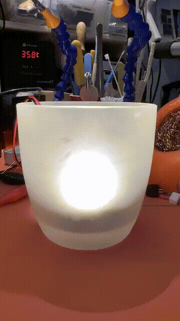
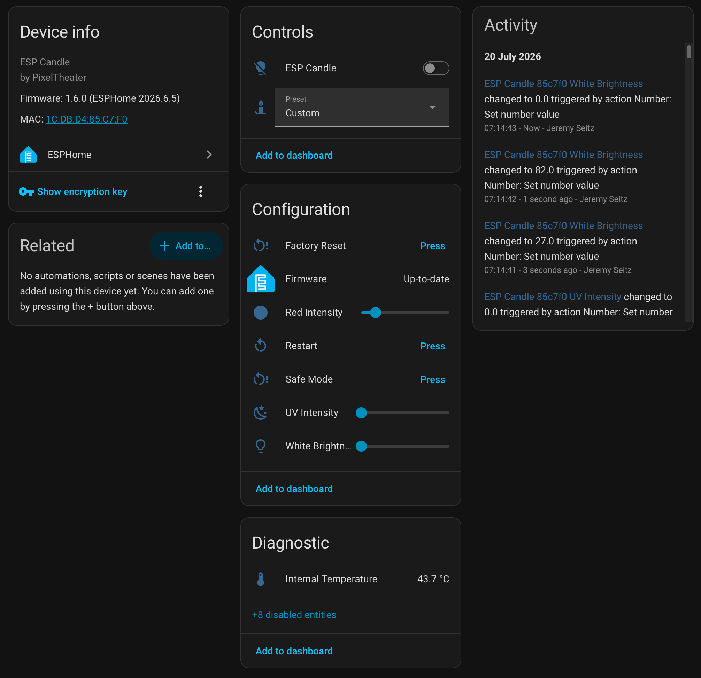
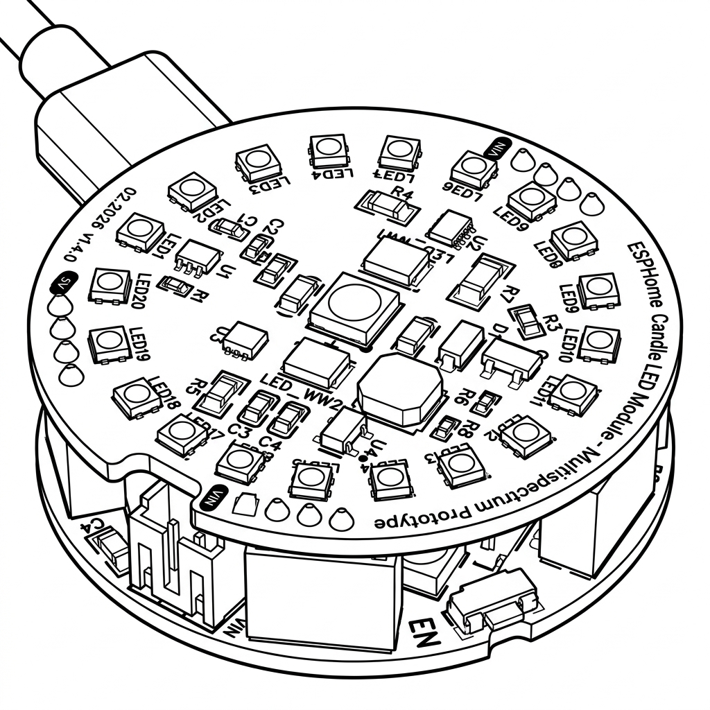

# ESP32 Candle Firmware




A tea candle-sized LED smart light for **Home Assistant via ESPHome**, with an optional standalone PlatformIO demo firmware. The PCB stack is 38.6mm in diameter and 2cm tall, so it fits a standard candle holder or lantern (>40mm round). It has RGB, warm white, deep red, and UV LEDs, and runs from USB-C or 6–20V DC.

> **HOW TO ORDER**: Pre-assembled candles — https://www.soliddifference.com/store — shipped from Switzerland.

## Home Assistant + ESPHome

The primary firmware path. Provision over Bluetooth or USB (Improv), adopt in Home Assistant with a runtime Noise encryption key — no secrets baked into the binary. Controls: one light (RGB + scene master), a Preset dropdown, and White / Red / UV level + enable for Custom.



| Control | Role |
|---|---|
| **ESP Candle** | Scene master brightness while a preset is active; in Custom, RGB strip on/off + colour + brightness |
| **Preset** | Scene: Off, Warm Glow, Natural, Ember, UV Accent, Candle (40%), Wifi RSSI (70%), Color (50%), Magic, Custom |
| **White / Red / UV** | Level (%) + enable switch. Any change leaves the scene for **Custom**; PWM is absolute (not gated by the RGB light) |
| **RGB Strip** | Gates WS2812 output only; colour is preserved when off. Does not affect White/Red/UV |
| **Top Board** (config) | Which LED board is fitted: v1.3, v1.4 or v1.6 (printed on the top board). Sets how the warm whites are driven; stored across reboots and updates. See [Board versions](#board-versions) |
| **Restart / Safe Mode / Factory Reset** | Recovery |
| **Internal Temperature** | ESP32 core temperature |

Boot button: short-press cycles Warm Glow → Natural → Candle → Wifi RSSI → Color → Magic; hold 3–10s then release to toggle; hold 10s for factory reset. Power cycle or firmware reboot returns to Preset Off (all outputs dark).

### End-user setup (no YAML)

1. Plug the candle into USB-C power.
2. Home Assistant sees it over Bluetooth and prompts **"Set up new ESPHome device?"**
3. Pick your Wi-Fi network, enter the password, submit (BLE Improv).
4. When the candle appears under Discovered, tap **Configure** — HA stores a per-device Noise key on the candle. No key to paste.
5. Done. Lights, presets, and diagnostics appear as above.
6. If the top board is not v1.4, set **Top Board** on the device page to the version printed on it (v1.3 or v1.6). A v1.6 top works on the v1.4 setting, only dimmer.

### Web flasher

Browser flashing is hosted at
[support.soliddifference.com/firmware/](https://support.soliddifference.com/firmware/)
(ESP Web Tools). Publishing a GitHub Release with the merged binaries activates
the ESP Candle card there — see [docs/support-site-release.md](docs/support-site-release.md).
Until the first release syncs, the card shows "coming soon". For local
development, use the flash path below.

### Build from this repo

| File | Role |
|---|---|
| `espcandle.base.yaml` | Hardware, provisioning, diagnostics. Single source for `project: version` and `min_version`. No secrets. |
| `espcandle.example.yaml` | Per-device named overlay (runtime PSK, no secrets). Copy to `candle-<name>.yaml` for a custom name. |
| `espcandle.factory.yaml` | Device Builder import target (generic name + MAC suffix). What HA imports on **Adopt**. |
| `espcandle.factory.factory.yaml` | Bench-flash image (same as factory for now). HTTP self-update disabled until a release publishes `manifest.json` + OTA bin. What `make factory` builds. |
| `secrets-example.yaml` | Dev/CI-only static-key path (see below). |

```bash
cd /path/to/espcandle-demo
python3.13 -m venv .venv            # Python 3.13, not 3.14
source .venv/bin/activate
pip install -r esphome/requirements.txt

make smoke-test      # config + compile, no hardware (PR gate)
make factory-run     # compile + flash + monitor factory image
make factory-run TOP=v1.6   # same, with Top Board defaulting to v1.6 on a fresh flash
```

Run these from the **repo root** (the root `Makefile` forwards into `esphome/`). Close any PlatformIO serial monitor first so the USB port is free. CI runs the same smoke test plus a PlatformIO demo build (`.github/workflows/ci.yml`). Full on-device runbook: [docs/testing.md](docs/testing.md).

Named per-device image (runtime PSK, no secrets):

```bash
cp esphome/espcandle.example.yaml esphome/candle-livingroom.yaml
# edit name / friendly_name in candle-livingroom.yaml
esphome run esphome/candle-livingroom.yaml
```

Offline static-key builds: copy `esphome/secrets-example.yaml` → `esphome/secrets.yaml` and follow the usage block at the bottom of that file (dev/CI only).

Custom effects live in `esphome/includes/candle_effects.h`. Modder options (I2C, GPIO 10/11/12, web server, alternate channel wiring): [docs/modders.md](docs/modders.md).

**Customising hardware for variants:** pin assignments, the default top board and power caps are `substitutions:` in `espcandle.base.yaml`. Override them in the per-device YAML before the `packages:` line. The white channel has a frequency, min power and max power per top (`white_v13_*`, `white_v14_*`, `white_v16_*`); for example, to start a v1.3 candle's whites a little lower in its driver's dead zone:

```yaml
substitutions:
  name: esp32-candle-prototype
  friendly_name: Prototype
  led_pin: GPIO32
  top_board: "v1.3"
  white_v13_min_power: "0.18"

packages:
  espcandle: !include espcandle.base.yaml
```

### How discovery works

- **mDNS / ZeroConf** — once on Wi-Fi, the candle announces `_esphomelib._tcp.local` on port 6053. Home Assistant's ESPHome integration listens for these and surfaces new devices under *Settings → Devices & Services → Discovered*.
- **Native API (Noise, runtime PSK)** — the `api:` block ships with no baked-in key. On first connect, Home Assistant sends a per-device Noise PSK via the `noise_encryption_set_key` RPC; the candle persists it in flash and disables plaintext thereafter. Requires ESPHome ≥ 2025.10.0 and `aioesphomeapi` ≥ 2025.10.0 (Home Assistant 2025.10+).
- **Improv Wi-Fi** — `esp32_improv` (BLE 5.0) and `improv_serial` (USB-CDC) provision Wi-Fi credentials with no YAML editing. BLE is the primary end-user path; USB-CDC is the web-flasher path.
- **Device Builder Adopt** — `espcandle.factory.yaml` carries a `dashboard_import:` line so the ESPHome Device Builder can **Take Control** of a discovered candle and import the full config.

The end-to-end call sequence: **USB-C power → BLE advert → Wi-Fi join → mDNS announce → HA adopts → PSK persisted**. See [docs/adoption-strategy.md](docs/adoption-strategy.md) for the full strategy and security model.

### Made for ESPHome

Checklist against [Made for ESPHome](https://esphome.io/guides/made_for_esphome/) (logos only after Open Home Foundation approval — do not display them yet):

| Requirement | Status |
|---|---|
| Runs ESPHome on ESP32-S3 | Yes |
| Open-source config users can modify | Yes (`esphome/` in this repo) |
| `esp32_improv` + `improv_serial` (USB) | Yes |
| `dashboard_import` with no secrets / default network | Yes (`espcandle.factory.yaml`) |
| Config compiles and runs with no user edits after adopt | Yes (runtime PSK path) |
| Every component has an `id` (Take Control / extend) | Yes |
| Product name does not contain “ESPHome” | Yes (“ESP Candle”) |
| Users can apply updates on ready-made devices | Partial — ESPHome OTA from HA works; HTTP self-update / web-flasher binary still need a published release |

Next steps when ready to apply: open a PR on [devices.esphome.io](https://github.com/esphome/devices), then email `esphome@openhomefoundation.org` with the PR link.

## Hardware Specifications



### Core Features

- **Custom PCB** with ESP32-S3 (4MB flash, 2MB quad PSRAM). Standalone builds use `boards/espcandle.json`; ESPHome uses the stock `esp32-s3-devkitc1-n4r2` memory profile. Pinout is candle-specific, not DevKitC.
- **Power Input**: 6-20v DC or USB-C
- **Form Factor**: 38.6mm diameter × 20mm tall (tea candle size)
- **Mounting**: Fits standard candle holders and lanterns (>40mm spaces)

### LED Configuration

- **2x Warm White LEDs**: driver and LED depend on the top board version (below)
- **2x Deep Red LEDs**: 620nm wavelength, 730 mcd
- **1x UV LED**: 365nm wavelength (PAM2804 driver, ~300mA)
- **20x RGB WS2812 LEDs**: 2020 package addressable LEDs

### Board versions

The candle is a stack of two boards. All base boards (v1.3, v1.3.1, v1.6) and top boards (v1.3, v1.4, v1.6) share the header pinout and the GPIO map, so any base fits any top and the firmware needs no base setting. Only the top's warm whites are driven differently; set **Top Board** (or `top_board` / the standalone env) to match:

| Top | White driver | White current | White LEDs | Firmware setting |
|---|---|---|---|---|
| v1.3 | PAM2804 buck (1 Ω sense) | 100 mA | Everlight 67-21S | 500 Hz; duty 20–50 % (lights from about 20 %) |
| v1.4 | BCR421U linear, REXT 10 Ω | about 88 mA | 2835 warm white | 5 kHz; duty up to 40 % (as since 0.2.0) |
| v1.6 | BCR421UW6Q linear, REXT 20 Ω | about 50 mA | ams OSRAM 2700 K, CRI 97 | 4 kHz (14-bit); duty up to 100 % |

The duty caps give about the same white at 100 % on every top, so scenes and sliders look alike. The v1.6 LEDs give about 0.7× the light per mA of v1.4's (estimated from the datasheets' flux tables), so v1.6 at 100 % matches v1.4 at its 40 % cap, with about five times finer steps at the low end. The v1.3 numbers come from bench tests of that top in 2026-02; its two PAM2804s can differ a little, so `white_v13_min_power` can be tuned per candle. The default is v1.4: a v1.6 top is only dimmer on it, while the v1.6 setting on a v1.4 top drives its whites at their full 88 mA.

The UV channel uses a PAM2804 driver, 4.7 µH inductor and 0.33 Ω sense at about 300 mA on every top. The red LEDs are switched by an AO3402 N-channel MOSFET with a series resistor each (82 Ω on v1.3, 68 Ω since v1.4), about 40 mA each.

The v1.6 base has a 2.5 A buck (LMR51625, was 1 A), a TPS2116 mux between USB and EXT power, reverse-polarity protection on EXT, ESD protection on USB, and 4.7 kΩ I2C pull-ups fitted (earlier bases have none). With all channels active, power consumption can reach 1.5 W.


### Connectivity & Power

- **USB-C Interface**: Power and firmware upload
- **JST SH (2.0mm)**: External power input with cable routing hole
- **Power Source Switch**: Toggle between USB-C and external power
- **I2C Connectors**:
  - JST SH 1.0mm QWICK connector
  - PCB headers
- **Extra Pads**: I2C and 5V power injection points

## PCB Pinout & Connectivity

### GPIO Pinout Summary

| GPIO | Function | Description |
|------|----------|-------------|
| 0 | Button Input | Boot button / Mode switching |
| 8 | I2C SDA | I2C data line |
| 9 | I2C SCL | I2C clock line |
| 10-12 | Extra GPIO | Available as digital outputs/inputs |
| 15 | PWM LED 1 | Warm White LED 1 (see Board versions) |
| 16 | PWM LED 2 | Warm White LED 2 (see Board versions) |
| 17 | PWM LED 3 | UV LED (365nm) |
| 18 | PWM LED 4 | Deep Red LED (620nm, 730 mcd) |
| 33 | WS2812 | RGB LED strip data (20x 2020 LEDs) |

### Additional Features

- **I2C Bus** (GPIO8/9): For sensors and expansion modules (pull-ups on the v1.6 base; earlier bases rely on the module's own)
- **Internal Temperature Sensor**: Monitor ESP32 core temperature
- **Extra GPIO Pins** (GPIO10-12): Configurable digital I/O
- **WiFi Connectivity**: For Home Assistant integration, ESPNow, etc.

## Standalone firmware (PlatformIO)

Optional demo firmware with built-in lighting modes and button control (no Home Assistant). For an Arduino `.ino` build, open a GitHub issue.

**Modes:** Candle, Color, Magic, Auto (cycles modes over time).

**Controls:** short press cycles modes; long press (3s) power on/off; serial at 115200 baud; EN for hardware reset.

```bash
pio run -e esp32s3 --target upload            # v1.4 top
pio run -e esp32s3-top-v16 --target upload    # v1.6 top (esp32s3-top-v13 for v1.3)
```

Pinout and caps live in `src/config.h`: PWM 12-bit, 5 kHz for UV and red; the whites at their top's frequency and caps (Board versions above, `ESPCANDLE_TOP`); UV 75%, red 80%; WS2812 brightness 64/255 on GPIO33.

## Hardware Setup

1. **Power Supply**:
   - **USB-C**: Connect USB-C cable for 5V power and programming
   - **External Power**: Use JST SH 2.0mm connector for 6-20V DC input
   - **Power Switch**: Toggle slide switch to select USB-C or external power source

2. **Form Factor**:
   - Diameter: 38.6mm (fits in standard >40mm candle holders)
   - Height: 20mm (2cm tall stack)
   - Designed to fit in tea light holders and lanterns

3. **I2C Expansion** (optional):
   - **QWICK Connector**: JST SH 1.0mm for easy sensor connections
   - **PCB Headers**: Traditional pin headers for breadboard connections
   - **Extra Pads**: I2C and 5V power injection points for custom wiring

4. **Programming**: Connect via USB-C for firmware upload and serial monitoring

## Troubleshooting

### Arduino Demo Issues

- **LEDs not working**: Check ESP-IDF version compatibility (requires 2.x LEDC syntax)
- **Button not responding**: Verify GPIO0 is pulled high and button grounds the pin
- **Serial output**: Connect to USB and monitor at 115200 baud

### ESPHome Issues

- **Device not discovered**: confirm the candle joined Wi-Fi - it should show as `esp32-candle-XXXXXX.local` on the network. If it didn't, it will fall back to its setup AP after ~90 seconds; re-run improv-serial from the web flasher or join the AP and use the captive portal.
- **API connection failed**: by default Home Assistant generates and stores a unique encryption key during adoption. If the device was reflashed, HA's stored key no longer matches and adoption fails - delete the device in HA and let it re-discover so a new key is negotiated. If you pinned a key in your per-device YAML, that value must match what HA has on file.
- **OTA update failed**: confirm the device is on Wi-Fi. If you set an OTA password, it must match the one used at flash time. Press the candle's **Safe Mode** button in HA, then retry.
- **Want to start over**: press **Factory Reset** in HA, or hold the boot button for 10 seconds — wipes Wi-Fi credentials and the API encryption key, then re-enters provisioning.

## Development Notes

- **ESP-IDF Compatibility**: Code is compatible with ESP-IDF 2.x (uses `ledcSetup` + `ledcAttachPin`)
- **Power Management**: PWM channels have safety limits to prevent LED overcurrent
- **Timing**: FastLED updates run at ~50Hz for smooth animations

## Release History

See [CHANGELOG.md](CHANGELOG.md) for release notes. Latest tag: `v0.5.0`.

## License

This project is licensed under the MIT License. See [LICENSE](LICENSE) for details.

## Contributing

Contributions welcome! Please submit pull requests or open issues for:
- New lighting effects
- Hardware variants
- Documentation improvements
- Bug fixes
