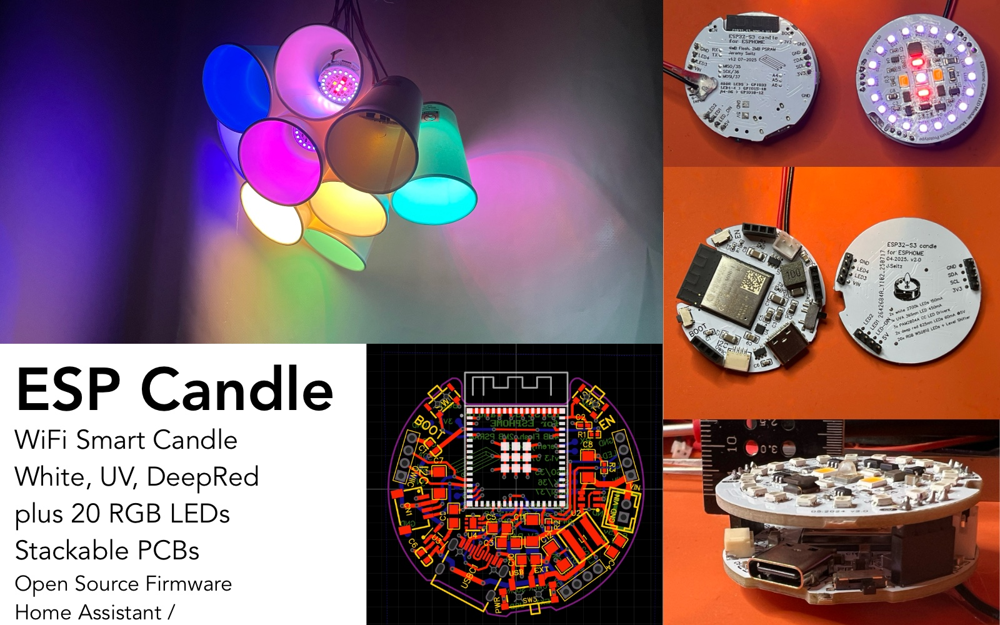
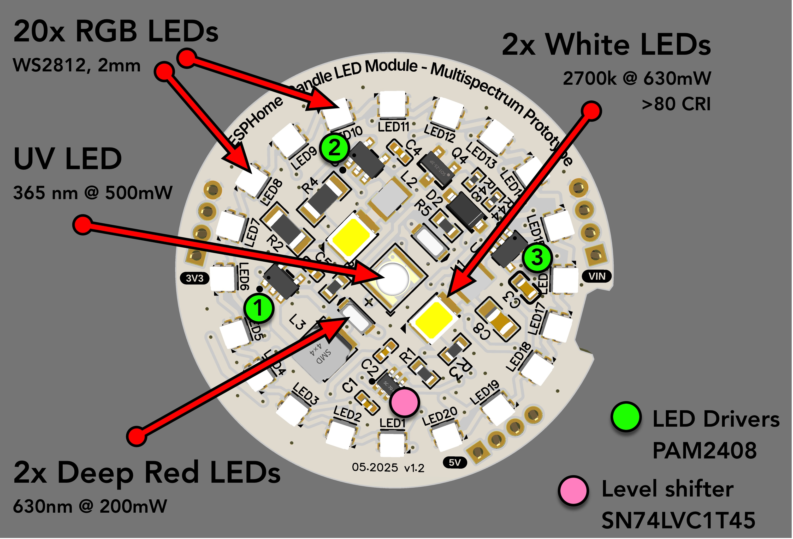
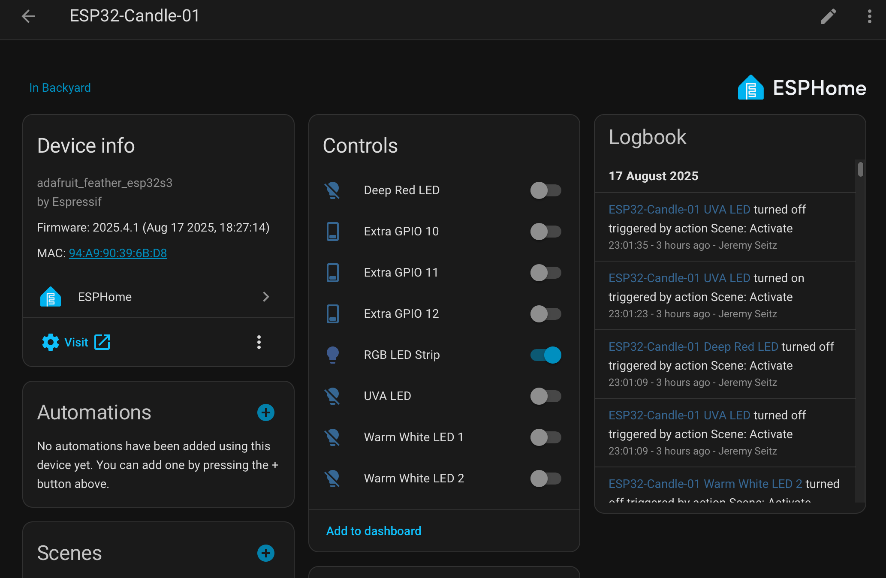

# ESP32 Candle Firmware




A tea candle-sized LED-powered smart light. The PCB stack is 38.6mm in diameter and 2cm tall, so that it can be placed in a standard candle holder or lantern (which are normally >40mm round spaces). It features RGB, a very bright warm white LED, and two UV LEDs. It can be powered by USB-C or via 6-20v DC external input.

This project supports both standalone Arduino firmware and Home Assistant integration via ESPHome.

> **HOW TO ORDER**: We will have a limited run of pre-assembled candles ready for shipment in **Jan 2026**, you can order here: https://www.soliddifference.com/store - shipped with love from Switzerland

## Hardware Specifications

### Core Features

- **ESP32-S3 Mini** with PSRAM
- **Power Input**: 6-20v DC or USB-C
- **Form Factor**: 38.6mm diameter × 20mm tall (tea candle size)
- **Mounting**: Fits standard candle holders and lanterns (>40mm spaces)

### LED Configuration

- **2x Bright White LEDs**: 2700K warm white, 0.5W at 150mA, 20,000 mcd
- **2x Deep Red LEDs**: 620nm wavelength, 730 mcd
- **1x UV LED**: 365nm wavelength, 500mA at 4V
- **20x RGB WS2812 LEDs**: 2020 package addressable LEDs

### Hardware v1.4

Both white LED channels now use a BCR421 linear constant-current regulator driver with 67-21S/KK7C-H276034Z15 LEDs (2700K, 150mA max, Vf around 3.2V). The **UV channel** uses a PAM2804 driver, 4.7uH inductor and 0.33 ohm Rsense at 300mA. The red LEDs are controlled with a N-channel mosfet (AO3402)PWM circuit, 35ma each. With all channels active, power consumption can reach 1.5w.



### Connectivity & Power

- **USB-C Interface**: Power and firmware upload
- **JST SH (2.0mm)**: External power input with cable routing hole
- **Power Source Switch**: Toggle between USB-C and external power
- **I2C Connectors**:
  - JST SH 1.0mm QWICK connector
  - PCB headers
- **Extra Pads**: I2C and 5V power injection points

## PCB Pinout & Connectivity

### GPIO Pinout Summary

| GPIO | Function | Description |
|------|----------|-------------|
| 0 | Button Input | Boot button / Mode switching |
| 8 | I2C SDA | I2C data line |
| 9 | I2C SCL | I2C clock line |
| 10-12 | Extra GPIO | Available as digital outputs/inputs |
| 15 | PWM LED 1 | Bright White LED (2700K, 0.5W at 150mA) |
| 16 | PWM LED 2 | Bright White LED (2700K, 0.5W at 150mA) |
| 17 | PWM LED 3 | UV LED (365nm) |
| 18 | PWM LED 4 | Deep Red LED (620nm, 730 mcd) |
| 33 | WS2812 | RGB LED strip data (20x 2020 LEDs) |

### Additional Features

- **I2C Bus** (GPIO8/9): For sensors and expansion modules
- **Internal Temperature Sensor**: Monitor ESP32 core temperature
- **Extra GPIO Pins** (GPIO10-12): Configurable digital I/O
- **WiFi Connectivity**: For Home Assistant integration, ESPNow, etc.

## Software Options

Choose between two firmware approaches based on your needs:

### Option 1: PlatformIO Demo (standalone) Firmware

A standalone firmware with built-in lighting modes and button control, build with PlatformIO. For an Arduino build (.ino), please open a GitHub issue in this repository and I'll try to help out.

#### Features

- **Candle Mode**: Realistic flickering using warm white and red LEDs
- **Color Mode**: Slowly rotating rainbow patterns on RGB strip
- **Magic Mode**: Green-to-purple transitions with UV LEDs active
- **Auto Mode**: Automatically cycles through all modes every 60 seconds

#### Controls

- **Short Press**: Cycle through modes (Candle → Color → Magic → Auto)
- **Long Press (3s)**: Power on/off
- **Serial Output**: Mode changes and status via USB (115200 baud)

#### Installation

1. Install PlatformIO (in VSCode or use the command line tools)
2. Clone this repository
3. Open the project in PlatformIO
4. Build and upload to your ESP32-S3 board:

   ```bash
   pio run --target upload
   ```

#### Configuration

The demo firmware is pre-configured for the PCB pinout. Key settings in `src/main.cpp`:
- PWM frequency: 5kHz, 8-bit resolution
- Max brightness: 30% (safety limit)
- WS2812: 25% brightness, 20 LEDs

The "boot" button will cycle through the modes. There are four modes:

- Candle: Realistic flickering using warm white and red LEDs
- Color: Slowly rotating rainbow patterns on RGB strip
- Magic: Green-to-purple transitions with UV LEDs active
- Auto: Automatically cycles through all modes over time.

The "EN" button will reset the device.

### Onboarding (ESPHome)

Full Home Assistant integration with advanced lighting effects and remote control. The candle ships with **no baked-in secrets**: Wi-Fi is provisioned over Improv (BLE or USB), and the per-device API encryption key is negotiated at runtime by Home Assistant on first adoption.



#### For end users (no build, no YAML)

1. Plug the candle into USB-C power.
2. Home Assistant sees it over Bluetooth and prompts **"Set up new ESPHome device?"**
3. Pick your Wi-Fi network, enter the password, submit. The candle joins Wi-Fi over BLE Improv.
4. Home Assistant sees the candle's mDNS announcement and prompts to **adopt**. Tap **Configure** — a per-device Noise encryption key is generated and stored on the candle automatically. No key to paste.
5. Done. The candle's lights, sensors, and switches appear in Home Assistant.

#### For end users (no build, web flasher)

If the candle is not yet flashed, or to re-flash from a browser:

1. Visit [web.esphome.io](https://web.esphome.io) in a Chromium-based browser (Chrome/Edge).
2. Connect the candle over USB-C and click **Connect**.
3. Pick `espcandle.factory.factory.yaml` and **Install**.
4. Continue from step 2 of the end-user flow above.

#### For developers (build from this repo)

The `esphome/` directory holds four files:

| File | Role |
|---|---|
| `espcandle.base.yaml` | Hardware, provisioning, diagnostics. Single source for `project: version` and `min_version`. No secrets. |
| `espcandle.example.yaml` | Per-device named overlay (runtime PSK, no secrets). Copy to `candle-<name>.yaml` for a custom name. |
| `espcandle.factory.yaml` | Device Builder import target (generic name + MAC suffix). What HA imports on **Adopt**. |
| `espcandle.factory.factory.yaml` | Bench-flash binary (the factory image + `http_request` OTA self-update). What `make factory` builds. |
| `secrets-example.yaml` | Dev/CI-only static-key path (see below). |

Build the factory image:

```bash
cd /path/to/espcandle-demo
python3.13 -m venv .venv            # Python 3.13, not 3.14
source .venv/bin/activate
pip install -r esphome/requirements.txt
make smoke-test          # config validation + compile, no hardware (PR gate)
make factory-run         # config + compile + flash + monitor (on-device)
```

`make smoke-test` is the no-hardware gate — run it before pushing. For the
full on-device runbook (provision, adopt, effect checks, known issues) see
[docs/testing.md](docs/testing.md).

Build a named per-device image (runtime PSK, no secrets):

```bash
cp esphome/espcandle.example.yaml esphome/candle-livingroom.yaml
# edit name / friendly_name in candle-livingroom.yaml
esphome run esphome/candle-livingroom.yaml
```

For a fully offline, static-key build (no HA runtime adoption), copy `esphome/secrets-example.yaml` to `esphome/secrets.yaml` and follow the commented usage block at the bottom of that file. This is the dev/CI path only.

**What the base exposes:** one user-facing light — **ESP Candle** — which joins the 20-LED RGB strip and the four PWM channels (warm white 1/2, UV, deep red) into a single logical light with **custom effects** named **Candle** (Perlin-noise flame on the warm whites + red ember), **Color** (HSV drift with spatial history), and **Magic** (drift/spark in purple/blue with UV + red drift) — ported from the standalone firmware into `esphome/includes/candle_effects.h`. Restart / Factory Reset / Safe Mode buttons. A compact diagnostic set (WiFi signal, uptime, internal temperature, IP/SSID/MAC, ESPHome version) — hidden by default to keep the UI clean; enable in HA as needed. The boot button short-press cycles effects; a 3-second hold toggles the candle on/off. The underlying per-channel lights are internal (not exposed). For I2C, extra GPIO 10/11/12, the web server, and direct per-channel control, see [docs/modders.md](docs/modders.md).

**Customising hardware for variants:** pin assignments and power caps are `substitutions:` in `espcandle.base.yaml`. Override them in the per-device YAML before the `packages:` line:

```yaml
substitutions:
  name: esp32-candle-prototype
  friendly_name: Prototype
  led_pin: GPIO32
  white_max_power: "50%"

packages:
  espcandle: !include espcandle.base.yaml
```

#### How discovery works

- **mDNS / ZeroConf** — once on Wi-Fi, the candle announces `_esphomelib._tcp.local` on port 6053. Home Assistant's ESPHome integration listens for these and surfaces new devices under *Settings → Devices & Services → Discovered*.
- **Native API (Noise, runtime PSK)** — the `api:` block ships with no baked-in key. On first connect, Home Assistant sends a per-device Noise PSK via the `noise_encryption_set_key` RPC; the candle persists it in flash and disables plaintext thereafter. Requires ESPHome ≥ 2025.10.0 and `aioesphomeapi` ≥ 2025.10.0 (Home Assistant 2025.10+).
- **Improv Wi-Fi** — `esp32_improv` (BLE 5.0) and `improv_serial` (USB-CDC) provision Wi-Fi credentials with no YAML editing. BLE is the primary end-user path; USB-CDC is the web-flasher path.
- **Device Builder Adopt** — `espcandle.factory.yaml` carries a `dashboard_import:` line so the ESPHome Device Builder can **Take Control** of a discovered candle and import the full config.

The end-to-end call sequence: **USB-C power → BLE advert → Wi-Fi join → mDNS announce → HA adopts → PSK persisted**. See [docs/adoption-strategy.md](docs/adoption-strategy.md) for the full strategy and security model.


## Hardware Setup

1. **Power Supply**:
   - **USB-C**: Connect USB-C cable for 5V power and programming
   - **External Power**: Use JST SH 2.0mm connector for 6-20V DC input
   - **Power Switch**: Toggle slide switch to select USB-C or external power source

2. **Form Factor**:
   - Diameter: 38.6mm (fits in standard >40mm candle holders)
   - Height: 20mm (2cm tall stack)
   - Designed to fit in tea light holders and lanterns

3. **I2C Expansion** (optional):
   - **QWICK Connector**: JST SH 1.0mm for easy sensor connections
   - **PCB Headers**: Traditional pin headers for breadboard connections
   - **Extra Pads**: I2C and 5V power injection points for custom wiring

4. **Programming**: Connect via USB-C for firmware upload and serial monitoring

## Troubleshooting

### Arduino Demo Issues

- **LEDs not working**: Check ESP-IDF version compatibility (requires 2.x LEDC syntax)
- **Button not responding**: Verify GPIO0 is pulled high and button grounds the pin
- **Serial output**: Connect to USB and monitor at 115200 baud

### ESPHome Issues

- **Device not discovered**: confirm the candle joined Wi-Fi - it should show as `esp32-candle-XXXXXX.local` on the network. If it didn't, it will fall back to its setup AP after ~90 seconds; re-run improv-serial from the web flasher or join the AP and use the captive portal.
- **API connection failed**: by default Home Assistant generates and stores a unique encryption key during adoption. If the device was reflashed, HA's stored key no longer matches and adoption fails - delete the device in HA and let it re-discover so a new key is negotiated. If you pinned a key in your per-device YAML, that value must match what HA has on file.
- **OTA update failed**: confirm the device is on Wi-Fi. If you set an OTA password, it must match the one used at flash time. Press the candle's **Safe Mode** button in HA, then retry.
- **Want to start over**: press **Factory Reset** in HA (or hold the boot button for 10s) - the candle wipes Wi-Fi creds and re-enters provisioning mode.

## Development Notes

- **ESP-IDF Compatibility**: Code is compatible with ESP-IDF 2.x (uses `ledcSetup` + `ledcAttachPin`)
- **Power Management**: PWM channels have safety limits to prevent LED overcurrent
- **Timing**: FastLED updates run at ~50Hz for smooth animations

## Release History

See [CHANGELOG.md](CHANGELOG.md) for release notes. The current release tag is [`v0.1.0`](https://github.com/PixelTheater/espcandle-demo/releases/tag/v0.1.0).

## License

This project is licensed under the MIT License. See [LICENSE](LICENSE) for details.

## Contributing

Contributions welcome! Please submit pull requests or open issues for:
- New lighting effects
- Hardware variants
- Documentation improvements
- Bug fixes
